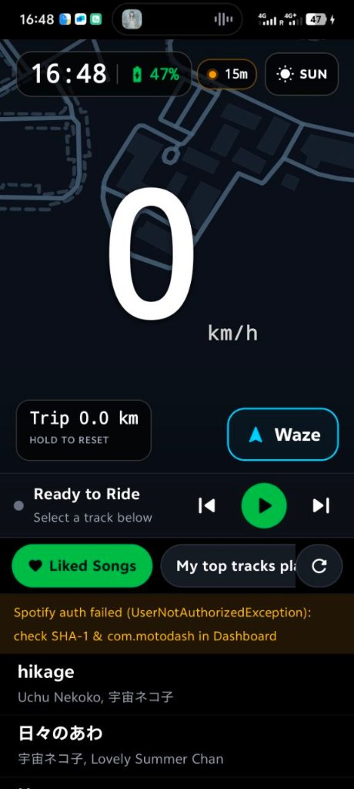
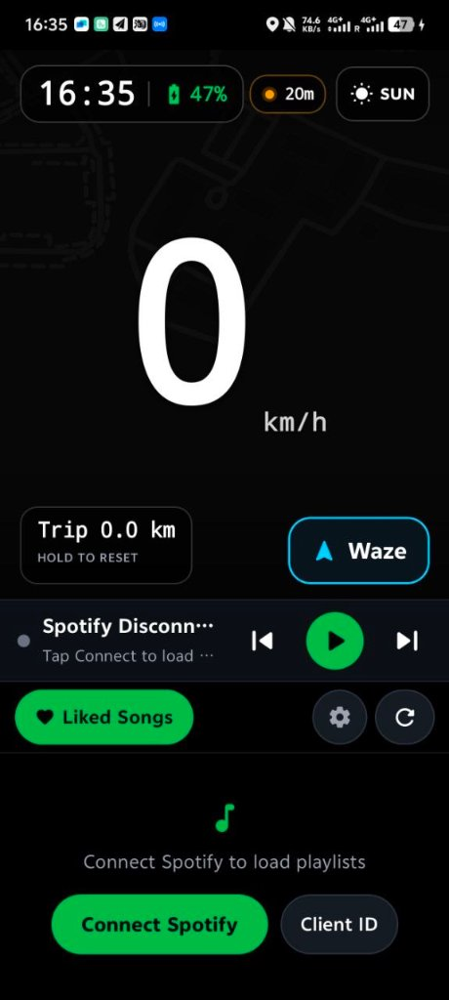
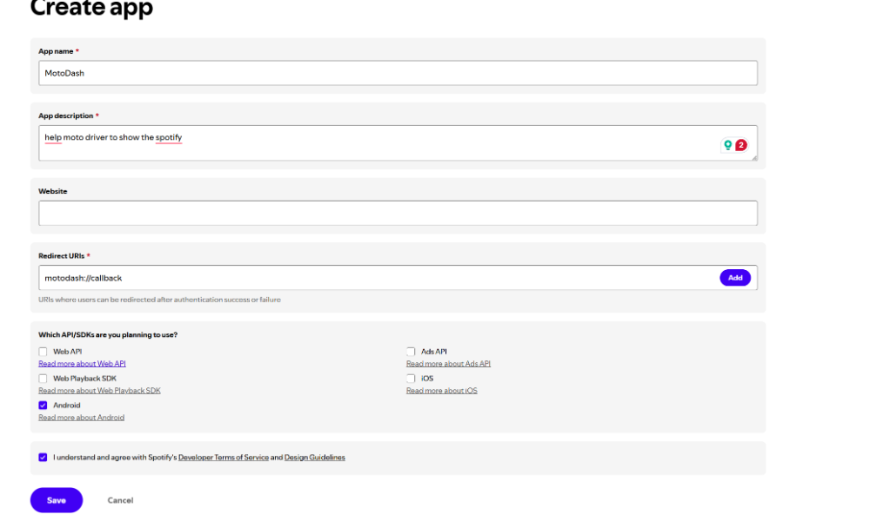

# MotoDash 🏍️

> **专为摩托车骑行者打造的极简双模智能中控仪表盘**  
> *A Minimalist Motorcycle Cockpit HUD & Glove-Friendly Music Controller for Android.*

[-brightgreen.svg)](https://developer.android.com)
[](https://kotlinlang.org)
[](https://developer.android.com/jetpack/compose)
[](https://openfreemap.org)
[-1DB954.svg)](https://developer.spotify.com)
[](LICENSE)

---

## 📖 项目简介 (Overview)

当手机固定在摩托车车把支架上时，常规手机应用在骑行场景下存在明显痛点：
1. **触控面积过小**：戴厚手套骑行时极易误触或无法精准点击；
2. **强光刺眼与眩光干扰**：常规浅色界面或花哨动画分散骑士注意力，消耗过多 OLED 电量并加剧发热；
3. **时速显示滞后**：传统 GPS 滤波算法往往在停车等红灯数秒后才能归零；
4. **切歌分心**：骑行中切换音乐歌单操作繁琐。

**MotoDash** 采用严格的 **60 / 40 黄金双模分割设计** 与 **AMOLED 纯黑原生夜间主题 (`#000000`)**：
- **上半屏 60% 极简智能 HUD**：车头朝向旋转的深色无 Key 矢量地图、前瞻视角骑行光标、自适应动态缩放、毫秒级敏捷响应数字码表、骑行轨迹记录仪（最高速/均速/零六加速/速度曲线），以及一键 Waze 导航拉起。
- **下半屏 40% 防抖大手套音乐中控**：超大触控热区（主按键 $\ge 64\text{dp}$，歌单胶囊 $\ge 44\text{dp}$，列表行高 $\ge 62\text{dp}$），双引擎架构（App Remote 本地控制 + Web API Connect 云端投送无缝冗余），支持离线 Room 数据库秒级缓存。

---

## 📸 界面预览 (Screenshots)

| 骑行 HUD 仪表盘与音乐中控 | 骑行 HUD 强光模式与 Waze 联动 |
|:---:|:---:|
|  |  |

---

## ✨ 核心特性 (Key Features)

### 1. 🏁 上半屏 60% 极简骑行 HUD 仪表

- **超高对比度 3D 旋转车头朝向地图**：
  - 基于 **MapLibre Native Android SDK** 与 **OpenFreeMap** 免费开源瓦片服务，**无需任何付费商业 API Key**，开箱即用。
  - 针对强光与夜间骑行专门强化道路层级对比度（主干道、高架、高速公路高亮区分）。
  - **前瞻骑行视野**：地图中心偏置于屏幕高度约 70% 处，将前方更开阔的路线尽收眼底。
  - **动态呼吸光标**：高辨识度青色脉冲箭头实时指示当前车辆经纬度与航向角（Bearing）。
- **自适应动态缩放 (Speed-Adaptive Dynamic Zoom)**：
  - 低速/起步（0 ~ 30 km/h）：自动推进至 `16.5` 级超清街区视角，方便看清岔路口。
  - 巡航/高速（80 ~ 120+ km/h）：平滑缩放至 `14.5` 级宏观视角，提前预知前方线形。
- **极致响应零停顿算法 (Asymmetric Debounced Speedometer)**：
  - **2Hz 原生 GNSS 原始采样** 结合智能保底融合定位（Fused Location Provider）。
  - **非对称平滑滤波**：加速阶段采用平滑 EMA 滤波消除颠簸抖动；制动减速采用高灵敏度衰减（$\alpha = 0.85$），并在低于 2.5 km/h 时立刻触发去抖归零，车停稳即刻归零，告别迟滞。
  - **竞速风格数字字形与三级颜色预警**：
    - `0 ~ 109 km/h`：纯白竞技斜体数字。
    - `110 ~ 129 km/h`：荧光橙色超速提醒。
    - `130 km/h+`：猩红极速警示。
- **骑行轨迹记录仪 (Trip Telemetry Recorder)**：
  - 一键开始/暂停记录行程。
  - 结束骑行时自动弹窗生成 **骑行报告卡片**：
    - 总行驶里程（公里）与骑行时间；
    - 全程最高时速与平均时速；
    - **0-60 km/h 起步加速实测耗时**（红绿灯起步测试神器）；
    - **平滑速度曲线折线图**（基于时间轴动态抽样与贝塞尔平滑渲染）。
- **一键快捷唤起 Waze 导航**：
  - 独立的大号 Waze 图标按钮，点击即可直接通过深层链接（`waze://`）调出导航路线。
- **状态看板**：
  - 超大清晰时间显示（48sp）、手机实时电量、GPS 搜星定位精度（米级）状态指示灯。

---

### 2. 🎧 下半屏 40% 防抖大手套音乐中控

- **戴手套防误触触控系统 (Glove-Friendly Touch Targets)**：
  - 所有核心交互按钮严格遵循摩托车手套工学，主播放/暂停按键达到 $64 \times 64\,\text{dp}$，歌单快捷胶囊高度 $44\,\text{dp}$，歌曲列表行高不低于 $62\,\text{dp}$。
- **双引擎播放架构 (Dual Engine Redundancy)**：
  - **引擎 A（原生本地直连）**：通过 Spotify Android App Remote SDK 跨进程通信，实现毫秒级播放、暂停、切歌与封面同步。
  - **引擎 B（Web API Connect 云端投送降级）**：即便设备因开发者签名（SHA-1）冲突或处于未认证开发模式，也能通过 Spotify Web API Connect（`PUT /v1/me/player/play`）实现自动发现设备并无缝投送播放，保证任何情况下均可正常听歌。
- **符合 Spotify 最新 2026 API 规范**：
  - 全面适配 Spotify 最新的 `/v1/playlists/{playlist_id}/items` 规范解析，支持“Liked Songs (我喜欢的音乐)”与自建歌单快速抓取。
- **离线 Room 数据库秒级加载**：
  - 歌单与曲目自动保存在本地 SQLite 数据库，无网环境或穿行山区隧道时瞬间载入离线歌单。

---

## 🏗️ 技术架构 (Architecture & Tech Stack)

```
                    ┌───────────────────────────────────────────┐
                    │            MotoDash Dashboard             │
                    │         Jetpack Compose + MVI             │
                    └─────────────────────┬─────────────────────┘
                                          │
                  ┌───────────────────────┴───────────────────────┐
                  ▼                                               ▼
    ┌───────────────────────────┐                   ┌───────────────────────────┐
    │     Upper HUD Section     │                   │    Lower Music Section    │
    │  (MapLibre + Telemetry)   │                   │ (Spotify Remote + Web API)│
    └─────────────┬─────────────┘                   └─────────────┬─────────────┘
                  │                                               │
        ┌─────────┴─────────┐                           ┌─────────┴─────────┐
        ▼                   ▼                           ▼                   ▼
┌───────────────┐   ┌───────────────┐           ┌───────────────┐   ┌───────────────┐
│ Dynamic Map   │   │ GNSS Speed    │           │ Spotify Remote│   │ Web API       │
│ OpenFreeMap   │   │ Asymmetric    │           │ App Remote    │   │ Connect Fall- │
│ TextureMode   │   │ EMA Filter    │           │ Local AAR     │   │ back Engine   │
└───────────────┘   └───────────────┘           └───────────────┘   └───────────────┘
```

- **UI 框架**：Jetpack Compose 1.7+、Material 3、Accompanist System UI Controller
- **地图引擎**：MapLibre Native Android SDK (`org.maplibre.gl:android-sdk:11.5.1`)
- **定位计算**：Android Native LocationManager (2Hz GNSS Updates) + Google Play Fused Location Provider
- **音乐中控**：Spotify App Remote SDK (`spotify-app-remote-release-0.8.0.aar`) + Retrofit 2 + OkHttp 3 + PKCE OAuth 2.0
- **持久化存储**：Android Jetpack Room 2.6+ (SQLite ORM) + SharedPreferences
- **字体资产**：Barlow Condensed 竞技运动斜体字体族

---

## 🚀 快速上手与编译指南 (Getting Started)

### 1. 环境准备 (Prerequisites)

- **JDK**：Java 17 或以上
- **Android SDK**：Compile SDK 35，Min SDK 26 (Android 8.0 Oreo 以上系统)
- **开发工具**：Android Studio Ladybug / Koala 或更高版本
- **手机配置**：开启手机的“开发者选项”与“USB 调试”，建议开启“始终保持屏幕常亮”。

### 2. 获取代码与配置 Spotify Client ID

1. 克隆代码仓库：
   ```bash
   git clone https://github.com/your-username/MotoDash.git
   cd MotoDash
   ```

2. 注册 Spotify 开发者应用：
   - 访问 [Spotify Developer Dashboard](https://developer.spotify.com/dashboard) 并登录。
   - 点击 **Create App**：
     - **App Name**：`MotoDash`
     - **Redirect URIs**：`motodash://callback`（务必添加此重定向地址并点击 Add）
     - **APIs used**：勾选 `Web API` 和 `Android`。
   - 创建成功后，复制页面上的 **Client ID**。

   

3. 配置本地属性文件：
   - 复制项目根目录下的 `local.properties.example` 为 `local.properties`：
     ```bash
     cp local.properties.example local.properties
     ```
   - 在 `local.properties` 中填入你的 Android SDK 路径与刚刚复制的 Spotify Client ID：
     ```properties
     sdk.dir=C\:\\Users\\YOUR_NAME\\AppData\\Local\\Android\\Sdk
     SPOTIFY_CLIENT_ID=your_spotify_client_id_here
     ```

### 3. 编译与运行 (Build & Run)

使用项目自带的 Gradle Wrapper 执行编译与测试：

- **运行单元测试与数学算法验证**：
  ```bash
  ./gradlew testDebugUnitTest
  # Windows PowerShell:
  .\gradlew.bat testDebugUnitTest
  ```

- **构建 Debug 安装包**：
  ```bash
  ./gradlew assembleDebug
  # Windows PowerShell:
  .\gradlew.bat assembleDebug
  ```

- **一键安装部署至已连接手机**：
  ```bash
  ./gradlew installDebug
  # Windows PowerShell:
  .\gradlew.bat installDebug
  ```

---

## 🔒 权限说明 (Permissions)

MotoDash 仅请求正常运行仪表盘和连接外设所必需的最少权限：

| 权限名称 | 用途说明 |
|:---|:---|
| `ACCESS_FINE_LOCATION` | 获取高精度的实时 GNSS 卫星定位、速度计算与地图位置跟随 |
| `ACCESS_COARSE_LOCATION` | 基站/Wi-Fi 粗略定位保底 |
| `INTERNET` | 获取 OpenFreeMap 矢量地图瓦片数据与 Spotify Web API 交互 |
| `ACCESS_NETWORK_STATE` | 监测网络连通状态以自动平滑切换离线缓存 |
| `WAKE_LOCK` | 骑行过程中防止屏幕自动变暗或息屏 |

---

## 🏍️ 骑行使用技巧与硬件推荐 (Rider's Guide)

1. **减震支架选择**：
   - 强烈建议搭配具备**硅胶减震模块**的摩托车手机支架（如 RAM Mounts、Quad Lock 减震版、五匹八爪等），避免单缸或大排量机车的剧烈震动损坏手机光学防抖（OIS）马达。
2. **防烧屏与发热控制**：
   - MotoDash 全局采用 `#000000` 纯黑像素底色，在 OLED / AMOLED 屏幕上绝大部分像素处于自发光关闭状态，极大幅度减小功耗并抑制长途骑行的机身发热。
3. **配合蓝牙耳机 / 头盔蓝牙**：
   - 手机通过蓝牙连接头盔耳机（Sena、Cardo、维邁通等），打开 Spotify 音乐，手机屏幕作为中控台，实现真正免掏手机的切歌体验。

---

## 🤝 参与贡献 (Contributing)

欢迎任何形式的贡献！无论是一个新功能建议、代码重构还是 Bug 报告：
1. Fork 本项目
2. 创建特性分支：`git checkout -b feature/awesome-feature`
3. 提交修改：`git commit -m 'feat: add awesome feature'`
4. 推送分支：`git push origin feature/awesome-feature`
5. 发起 Pull Request

---

## 📄 开源协议 (License)

本项目基于 [MIT License](LICENSE) 协议开源。可自由使用、修改及商用，请保留原版权与免责声明。

---

## 🙏 致谢与参考 (Acknowledgements)

- [OpenFreeMap](https://openfreemap.org) - 稳定、免费、无 Key 的高质量全球矢量深色瓦片服务
- [MapLibre Native Android](https://github.com/maplibre/maplibre-native) - 高性能开源移动端矢量地图渲染引擎
- [Spotify for Developers](https://developer.spotify.com) - 强大的音频生态 API & SDK
- [Jetpack Compose](https://developer.android.com/jetpack/compose) - Android 现代响应式 UI 工具包
